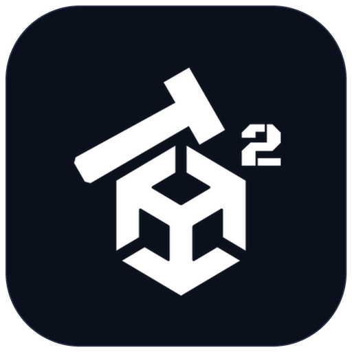
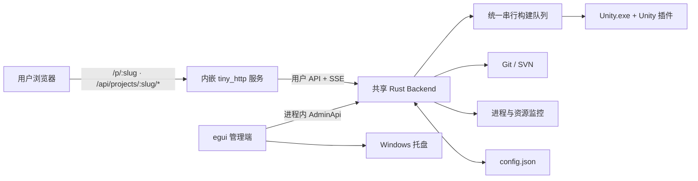

# UnityBuildTool

<p align="center">
  
</p>

<h3 align="center">面向 Unity 团队的原生 Windows 构建控制台</h3>

<p align="center">
  构建队列 · 环境检测 · Git/SVN 更新 · Player Settings · 实时监控 · 安全归档
</p>

<p align="center">
  <a href="https://github.com/TouMingQAQ/UnityBuildTool/releases/latest">
    
  </a>
  
  
  
  
</p>

UnityBuildTool 将多项目管理、Unity 命令行构建、统一队列、产物归档、环境检测、Git/SVN 同步、AI 失败诊断和运行监控收进一个 Windows 原生管理端。管理端基于 Rust 与 `eframe/egui`，业务后端在进程内直接运行，不再依赖 WebView2 或浏览器管理页面。

用户端仍通过内嵌 `tiny_http` 服务访问。`apps/user/public` 的页面、用户 HTTP API、SSE 事件和下载行为保持兼容；管理端迁移不会改变团队成员的日常使用方式。

## 核心能力

- **原生管理端**：单窗口管理全部项目，支持托盘常驻、关闭隐藏、全局任务状态和深色主题。
- **统一构建队列**：按项目隔离构建节点与用户入口，所有构建串行执行，避免同时抢占 Unity 许可和机器资源。
- **构建节点与分组**：扫描 Build Profile，管理节点增删改复制、拖拽排序与归组，支持固定或自动构建号。
- **完整构建流水线**：DEV、Addressables、自动压缩、Android APK/AAB/Gradle、keystore、构建前 VCS 更新和自定义产物目录。
- **过程可见**：实时展示构建阶段、进度、产物、分频道日志、CPU/内存趋势和任务队列。
- **环境与版本管理**：检测 Unity/Android 构建环境；探测 Git/SVN 仓库、分支与还原命令，并批量更新节点。
- **Player Settings 读改写**：编辑 Product Name、Company Name 和 Version，兼顾 Unity 6 Build Profile 与旧版工程。
- **安全归档**：构建 ZIP 自动排除日志、临时文件、检测结果和 Unity 调试目录，不把内部诊断信息交给用户。
- **轻量用户 Web**：选择本项目节点、查看 SSE 构建进度、浏览产物并下载文件或目录 ZIP，无管理权限入口。

## 架构



管理端与 HTTP 服务共享同一个 `Arc<Backend>`。所有管理操作直接调用 Rust 业务层，不经过管理 HTTP API，也不会暴露管理令牌、Cookie 或浏览器备用入口。

## 快速开始

### 直接使用

1. 从 [GitHub Releases](https://github.com/TouMingQAQ/UnityBuildTool/releases/latest) 下载最新 Windows 安装包。
2. 运行 `unitybuildtool-admin_<version>_x64-setup.exe`。
3. 启动“UnityBuildTool 管理端”，在“设置”中添加 Unity 项目。
4. 在顶部复制服务地址，或从托盘菜单打开用户网页。

正式安装版使用以下配置与运行时目录：

```text
%APPDATA%\com.unitybuildtool.admin\config.json
%APPDATA%\com.unitybuildtool.admin\
```

### 从源码运行

环境要求：

| 依赖 | 说明 |
| --- | --- |
| Windows 10/11 x64 | 当前仅发布 Windows |
| Rust stable | 编译管理端与用户 Web 服务 |
| Visual Studio C++ Build Tools | 提供 Windows Rust 链接环境 |
| Node.js 20+ | 仅用于开发脚本、语法检查和 legacy Web 测试 |

```powershell
git clone https://github.com/TouMingQAQ/UnityBuildTool.git
cd UnityBuildTool
npm run app:dev
```

调试版读取仓库内的 `web/config.json`，运行时根目录为 `web`。运行时不依赖 Node.js，桌面程序会自行启动内嵌 HTTP 服务。

## 管理端

窗口默认 `800 × 600`，最小 `640 × 480`。关闭按钮不会退出程序，而是隐藏到系统托盘；HTTP 服务在窗口隐藏期间继续运行。

| 页面 | 功能 |
| --- | --- |
| **构建** | 选择分组与节点、固定/自动构建号、失败停止、命令预览、开始/停止、AI 分析、Profile 阶段进度、产物表格和构建日志 |
| **监控** | 全部项目卡片、调度队列、CPU/内存趋势、任务状态、Application 路径、产物浏览、分频道日志和用户网页入口 |
| **Profile 与节点** | 扫描 Profile，编辑节点和分组，拖拽排序/归组，配置构建目录、命名模板、压缩、DEV、Addressables、Android 与 VCS 参数 |
| **环境检测** | 选择目标环境线、超时和无图形选项，预览命令、启动/停止检测，查看结果统计与筛选日志 |
| **版本管理** | 管理 Git/SVN 节点与分组，探测仓库和分支，使用还原命令预设，全部更新/停止并查看实时日志 |
| **设置** | 项目 CRUD、监听地址/端口、Unity 与模板模式、归档默认值、Android SDK/NDK/JDK、代理、AI 和路径配置 |
| **帮助** | 内置完整中文使用说明、托盘行为、配置路径和升级说明 |

托盘操作：

- 左键单击：显示或隐藏管理端。
- 右键菜单：显示/隐藏管理端、打开用户网页、退出。
- 退出：先停止构建、检测和 VCS 任务，等待 Unity 与版本控制子进程退出，再释放监听端口并关闭程序。

设置和节点编辑采用本地草稿、400ms 防抖自动保存和单飞写队列。任务运行或排队期间拒绝写操作；保存失败会保留草稿并显示可重试错误。构建、检测和 VCS 更新开始前会先确保配置保存完成。

构建、检测和 VCS 日志视图各保留最近 5000 行，支持搜索、复制、自动滚动和清空当前视图。完整日志仍保存在原日志文件中。

## 用户 Web

用户入口按项目隔离：

```text
http://127.0.0.1:50345/p/<slug>
http://127.0.0.1:50345/p/<slug>/workspace
```

项目 API 位于 `/api/projects/:slug/*`，SSE 只推送脱敏后的构建生命周期、进度和状态。用户只能选择、构建和下载自己项目的节点与产物；不同项目之间不能交叉操作。

用户 Web 不提供上传、登录或管理功能。`/admin/`、`/api/config`、`/api/status`、`/api/monitor`、`/api/build/*`、`/api/check/*`、`/api/vcs/*` 等旧管理入口统一返回 404。Host 校验、跨站写入校验、请求体限制、下载路径和符号链接防护仍然保留。

## Player Settings

构建节点可以直接读取和写回以下 Player Settings：

- Product Name
- Company Name
- Version

支持 Unity 6 Build Profile 覆盖，并在没有 Build Profile 时回退到旧版 `ProjectSettings/ProjectSettings.asset`。写入前使用 SHA-256 revision 检查外部修改，通过临时文件原子替换目标文件。revision 冲突、任务运行中或文件不可写时拒绝保存，避免覆盖其他编辑器或工具正在修改的工程文件。

## 构建归档

> [!IMPORTANT]
> 构建日志、检测日志和内部诊断文件不会进入产物 ZIP。完整日志只保留在节点输出目录，不随构建产物分发给用户。

归档时会排除：

- `build.log`、`process.log` 以及其他 `.log` 文件
- `.buildtool`、`check-results`、`logs`
- `.tmp`、`.temp`、`.bak` 和崩溃转储等临时/诊断文件
- `build-result.json` 以及重复的 APK/AAB/ZIP 产物
- Unity `DoNotShip`、`BackupThisFolder...` 等调试目录

Windows 与 Android 等目标的实际过滤在 Rust 后端统一执行，并由归档测试覆盖。

## 构建安装包

安装包使用 `cargo-packager 0.11.8` 生成 NSIS。首次构建前安装固定版本：

```powershell
cargo install cargo-packager --version 0.11.8 --locked
npm run build:admin
```

产物位于：

```text
target/release/bundle/nsis/*.exe
```

安装契约：

| 配置项 | 值 |
| --- | --- |
| 主程序 | `unitybuildtool-admin.exe` |
| 产品名 | `UnityBuildTool` |
| Publisher | `unitybuildtool` |
| Identifier | `com.unitybuildtool.admin` |
| 安装模式 | 当前用户 |
| 卸载键 | `HKCU\Software\Microsoft\Windows\CurrentVersion\Uninstall\UnityBuildTool` |

升级安装会继承旧自定义安装目录，例如 `E:\UnityBuildTool`。安装器先结束旧管理端进程，再读取旧卸载信息并静默执行旧卸载器；没有旧安装时安全跳过。升级不会删除 `%APPDATA%\com.unitybuildtool.admin`。卸载器提供可选的配置目录删除项，默认保留配置。

## 开发与验证

| 命令 | 用途 |
| --- | --- |
| `npm run app:dev` | 使用调试配置启动 egui 管理端 |
| `npm run check` | 检查用户 Web 与 legacy 服务 JavaScript 语法 |
| `npm run check:rust` | 对 Rust 管理端执行 `cargo check` |
| `npm test` | 运行全部 Rust 与 legacy 用户 Web 测试 |
| `npm run test:rust` | 仅运行 Rust Backend、Player Settings、HTTP 与 UI 辅助测试 |
| `npm run test:legacy` | 仅运行 legacy Node 用户 Web 测试 |
| `npm run build:admin` | 构建 release 程序并生成 NSIS 安装包 |

GitHub Release 工作流会在 `v*` 标签上运行 `npm run check`、`npm test` 和 `npm run build:admin`，上传 `target/release/bundle/nsis/*.exe`，并将同一安装包附加到 GitHub Release。

## 目录结构

```text
UnityBuildTool/
├─ apps/
│  ├─ admin/desktop/      Rust Backend、egui 管理端、托盘、HTTP 服务与打包资源
│  └─ user/public/        正式用户 Web 页面（保持兼容）
├─ unity/                 Unity 插件、命令行构建与进度钩子
├─ web/                   Legacy Node 用户 Web 参考服务与回归测试
├─ docs/assets/           README 展示资源
├─ scripts/admin.js       开发、检查、测试与打包入口
├─ packager.toml          cargo-packager / NSIS 配置
└─ package.json           根 npm 命令
```

## 兼容性说明

- 当前仅支持 Windows 发布，不提供 macOS/Linux 安装包。
- 管理端已从旧 WebView 管理页面迁移到原生 egui，不保留旧管理网页和管理 HTTP API。
- 用户 Web 的 URL、HTTP 方法、JSON 字段、SSE 事件和下载行为保持兼容。
- `config.json` 保持 `schemaVersion: 2`，现有字段、默认值、迁移行为和未知字段均会保留。
- 构建、检测、VCS、AI 和监控仍由原有 Rust Backend 执行，迁移未重写核心业务能力。

<p align="center">
  <sub>如果 UnityBuildTool 对你有帮助，欢迎 Star ⭐</sub>
</p>
